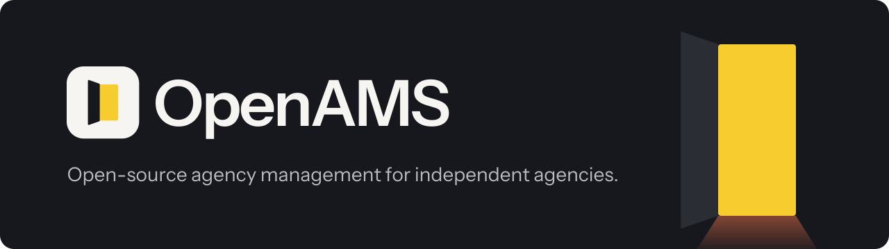
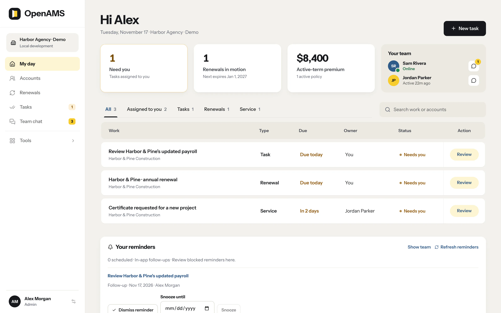
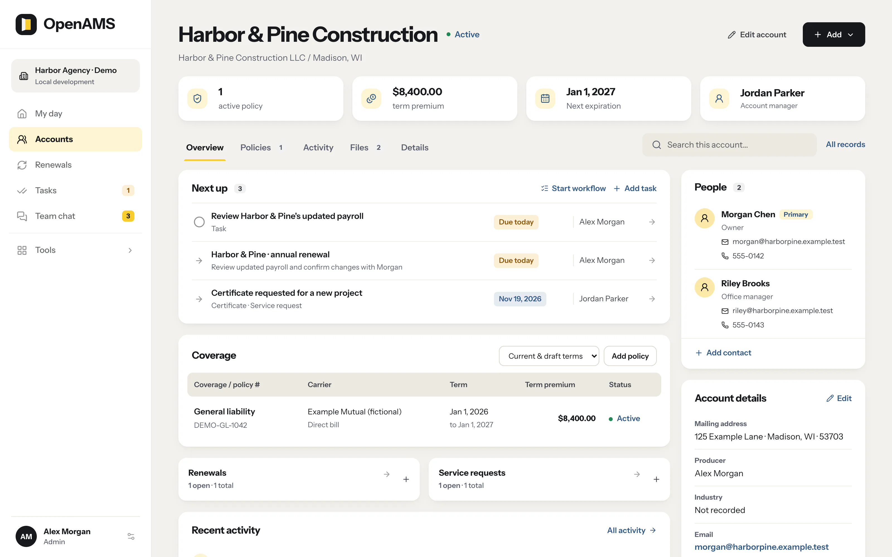

<p align="center">
  Your book. Your data. Software your team actually likes using.
</p>

<p align="center">
  <a href="https://openams.com">OpenAMS Cloud</a> ·
  <a href="https://demo.openams.com">Public demo</a> ·
  <a href="docs/self-hosting.md">Self-host</a> ·
  <a href="ROADMAP.md">Roadmap</a>
</p>

---

> **Status: OpenAMS Cloud is open.** There are three ways to use OpenAMS today:
>
> - **[OpenAMS Cloud](https://openams.com).** The maintainers host, update and back
>   up OpenAMS for your agency, with 14 days free to start. See
>   [pricing](https://openams.com/pricing).
> - **[The public demo](https://demo.openams.com).** A fictional agency you can
>   click through without signing in. It holds fictional records only and resets.
> - **Self-host.** Run the same code in your own Google Cloud project with no
>   license fee. You operate it: backups, updates and security are yours. Follow the
>   [self-hosting runbook](docs/self-hosting.md) and complete the
>   [launch checklist](docs/firebase.md#launch-checklist) before you store real
>   client data.
>
> Not supported yet: agency-bill accounting, carrier downloads, ACORD forms, a
> public API and webhooks, and self-hosting on Docker Compose with PostgreSQL.
> The [roadmap](ROADMAP.md) separates what exists from what is planned.

<p>
  
  
</p>

<sub>The fictional demo agency in the Desert dusk color scheme (Settings → Appearance). Screens will change as the first milestone lands.</sub>

## What OpenAMS is

OpenAMS is an agency management system (AMS) for U.S. independent property and
casualty agencies. It keeps accounts, contacts, policies, renewals, servicing
work, documents and commissions in one place.

Most agencies run on an AMS that is old, closed and expensive to leave. OpenAMS
is built to be:

- **Simple to use.** A new CSR should be productive in their first day, not after weeks of training.
- **Open.** Licensed under AGPLv3. Read the code, run it yourself and keep a full copy of your data.
- **Low cost.** Self-hosting has no license fee. [OpenAMS Cloud](https://openams.com/pricing) is the hosted version run by the maintainers, for agencies that don't want to run servers.
- **Built to connect.** It will have a documented API and webhooks, so carriers, raters and AI tools can work with your book without a partner program.

## Works with Relay

OpenAMS is the system of record. [Relay](https://relayins.com) is an optional AI
layer from the same team. It handles quoting, email filing and an assistant on top
of your accounts. OpenAMS works fully without Relay, and connections stay opt-in.

## Try it locally

You need Node.js 24.22.1 or a newer Node 24 release (`nvm use` reads `.nvmrc`).

```sh
git clone https://github.com/evangauer/openams.git
cd openams
npm install
npm run dev
```

Open http://127.0.0.1:4500 and choose **Explore demo agency** to look around a
fictional agency with accounts, policies, renewals and tasks already in it. You can
also continue as a local test role (admin, member, accountant or viewer) to work in an
empty agency. To try an import, open **Import agency records**. For each record type, **Fictional
sample** downloads a sample CSV (a made-up book of 8 accounts, 12 policies, contacts,
notes and tasks). Choose that file as the CSV file, then **Validate without importing**
to see a dry run before anything is saved.

Records and uploaded files persist in `~/.openams/local` (set
`AMS_LOCAL_DIRECTORY` to use another folder). Both servers bind to 127.0.0.1 only.
Nothing is sent to carriers, mailboxes or payment providers.

Optional [Incoming mail](docs/mailboxes.md) supports read-only Gmail and Microsoft
365 connections with a shared review and filing queue. Provider credentials and
consent are required; the local demo leaves live connections disabled.

[Hosted forms](docs/forms.md) let clients send you their information and files from a
link. In the demo agency, open **Tools → Forms**: a sample form is live with two
submissions waiting to be filed.

```sh
npm run check    # release hygiene, typecheck, tests and production build
npm run backup -- create ~/.openams/local ~/openams-backup   # local backup
```

## Host it for your agency

Each OpenAMS deployment is one agency's system, in a cloud project the agency owns.

1. **Deploy** to your own Google Cloud project with
   [the self-hosting runbook](docs/self-hosting.md). It's written so that you, or an AI
   coding agent you supervise, can follow it step by step, and it ends with
   `npm run verify:deployment` to check the result from outside.
2. **Set up your agency.** Sign in with the administrator email you chose during
   deployment and enter your agency's name and time zone. Nobody else can sign up.
3. **Invite your team** from the Team page, then **import your book** from CSV with a dry
   run before anything is saved.

See [self-hosting options](docs/self-hosting-options.md) for what works today and
what remains to be implemented for Supabase or Docker Compose with PostgreSQL.

Complete the [launch checklist](docs/firebase.md#launch-checklist) before you store real
client data.

## Project layout

```
openams/
├── apps/
│   ├── api/        # Agency records API: accounts, policies, renewals, tasks, money
│   └── web/        # Next.js agency workspace
├── packages/
│   └── contracts/  # Shared record schemas and permissions (zod)
├── brand/          # Logo, colors, type and social assets
├── docs/           # Architecture and contributor documentation
└── scripts/        # Local launcher, backup/restore and release checks
```

See [docs/architecture.md](docs/architecture.md) for how the pieces fit together.

## Contributing

Issues and ideas are welcome. Evaluation releases are scoped in
[docs/evaluation-releases.md](docs/evaluation-releases.md). See [CONTRIBUTING.md](CONTRIBUTING.md) for how
outside code contributions will work, and [SECURITY.md](SECURITY.md) to report a
vulnerability privately.

## License

OpenAMS is licensed under the [GNU Affero General Public License v3.0](LICENSE).
Running OpenAMS for your own agency carries no extra obligation. If you run a
modified version as a network service for others, you must share those changes.
